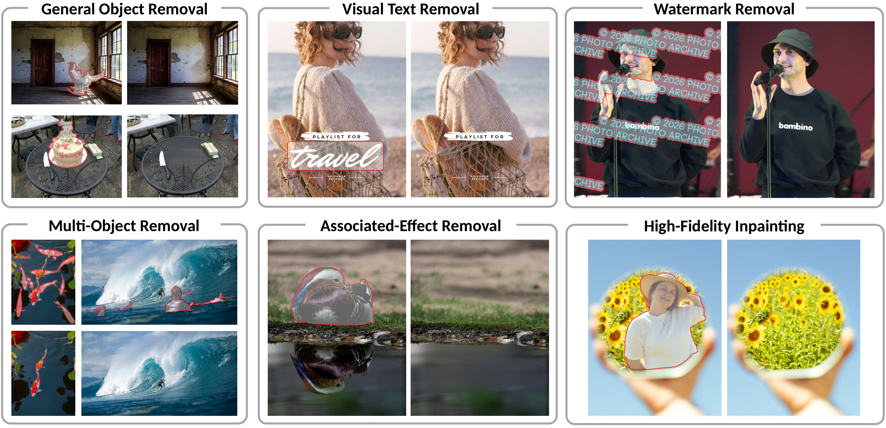

# LensErase

### A Foundation Model for Erase Anything

Yunuo Chen1,*, Xiuyu Wu2,*, Qinhong Yang3, Jinjing Zhao4, Yanchen Dong5, Sirui Zhang3, 
Dong Chen6,‡, Fangyun Wei6,†, Lei Shi6, Ji Li6, Dongdong Chen6, 
Guo Lu1,†, Yan Lu6, Baining Guo6

1 Shanghai Jiao Tong University &nbsp; 2 Nankai University &nbsp; 3 USTC 
4 University of Sydney &nbsp; 5 Peking University &nbsp; 6 Microsoft 
* Equal contribution &nbsp; † Corresponding authors &nbsp; ‡ Project lead

&nbsp;

&nbsp;

&nbsp;

**Code coming soon.** If you like LensErase, please consider starring this repository.

Selected inputs and LensErase outputs. Visit the project page for animated examples and model comparisons.

## Overview

**LensErase** is a general-purpose, mask-based foundation model for object removal. Given an image and a selection mask, it removes the selected content and associated visual effects, fills the revealed region, and preserves the rest of the image. It supports general objects, visual text, watermarks, and layered posters, including multiple targets and semi-transparent content.

## Highlights

- **An image and a mask.** Specify the region to erase without a text prompt.
- **Beyond the selected object.** Remove associated shadows and reflections while preserving nearby content.
- **A generative foundation for erasure.** Adapt the pretrained [Lens](https://github.com/LensFamily/Lens) model with Mask-Aware RoPE, then refine removals through supervised fine-tuning and contract-guided reinforcement learning.
- **High-fidelity preservation.** TraceFusion uses image residuals to identify the effective edit region and preserve content elsewhere.

## Data and Evaluation

| Resource | Scale | Description |
| :--- | :---: | :--- |
| **LensErase-100M** | **101.07M** paired examples | Source–mask–target triplets spanning general objects, watermarks, large masks, visual text, and posters. |
| **LensErase-Bench** | **500** cases | General objects, posters, watermarks, and visual text, evaluated without requiring a paired ground-truth target. |

LensErase-Bench evaluates **Removal**, **Inpainting**, **Preservation**, and **Cleanliness**, together with an Overall Score and **HiFi Removal**. The [project page](https://lensfamily.github.io/LensErase/#benchmark) describes the benchmark and its metrics.

## Examples

Explore the [animated removal demos](https://lensfamily.github.io/LensErase/#featured), [additional examples](https://lensfamily.github.io/LensErase/#showcase), and qualitative comparisons with [GPT-Image 2.5 and Flux2-Erase](https://lensfamily.github.io/LensErase/#commercial) and [open-source models](https://lensfamily.github.io/LensErase/#open-source).

## Release Status

**Code coming soon.** The code will be released in this repository.

### Paper

[LensErase: A Foundation Model for Erase Anything](https://arxiv.org/abs/2610.18072) (arXiv:2610.18072).

## Related Project

[Lens: Rethinking Training Efficiency for Foundational Text-to-Image Models](https://github.com/LensFamily/Lens) provides the pretrained text-to-image foundation for LensErase.
